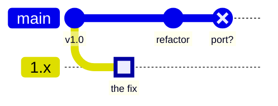
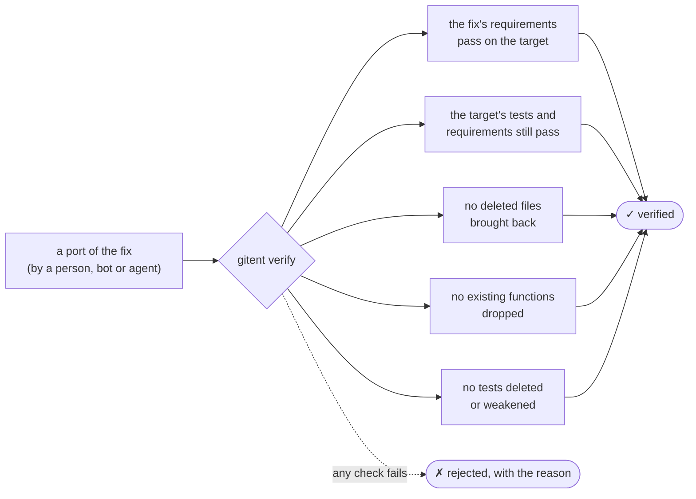
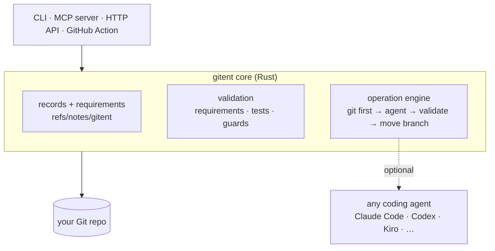

<div align="center">

# gitent

### Did that backport *actually* carry the fix?

**Gitent checks it, for backports, cherry-picks, merges and reverts made by people, bots or AI agents.**

[](https://github.com/eladb3/gitent/actions/workflows/ci.yml)
[](https://github.com/eladb3/gitent/actions/workflows/action-selftest.yml)


<sub>60-second demo (real output, reproducible with <a href="docs/demo/demo.sh"><code>docs/demo/demo.sh</code></a>) · <a href="docs/demo/demo.mp4">MP4</a></sub>

</div>

---

## The problem

You fix a bug on one branch and need the same fix on another, a release branch
or a fork. But **the code there has moved on**: functions were renamed, files
moved, units changed.



* `git cherry-pick` **conflicts**, or worse, applies cleanly and is **silently wrong**.
* So a person or an AI agent re-does the fix by hand, and says *"done, tests pass"*.
* Do the tests prove the fix actually landed? Not necessarily. A quick port can
  copy the old file back, so the tests pass against the resurrected code while
  `main`'s real code never gets the fix. Or a test gets deleted along the way.

## What Gitent does

Gitent records **what each change is for and what it must keep doing**. It then
**checks** that every port of that change still does it.

| | | |
|---|---|---|
| 🧾 **Record** | `gitent commit` | Stores the change's intent and **requirements** next to the Git commit. Every test you add becomes a requirement, *proven* to fail before the change and pass after it. |
| 🔍 **Verify** | `gitent verify <fix>` | Checks that a port carries the fix: the fix's requirements pass on the target, the target's own tests and requirements still pass, nothing was resurrected, dropped or deleted. **No AI is needed.** |
| 🤖 **Operate** *(optional)* | `gitent cherry-pick <fix>` | Tries Git first. If Git can't do it, hands the job to *your* coding agent in an isolated worktree, verifies the result, and only then moves your branch. |

It is **not a Git replacement.** A Gitent repo is a Git repo, and records live
in Git notes (`refs/notes/gitent`). Keep using Git every day; reach for Gitent
when a change has to move.

## What `verify` checks



The output on a bad port, from the demo above:

```text
$ gitent verify 1.x
✗ rejected: apply of 6ff94c5b2c onto 18d473b5b8 → df7bda7eb6
  ✓ requirements               1 executable requirement(s) satisfied
  ✓ tests                      `python3 -m unittest discover -q` passed in 47 ms
  ✗ target_preserved           recreates path(s) the target deliberately deleted: app/users.py
```

The tests pass, the agent says "done", and Gitent still says no.

## Quick start

```bash
cargo install --git https://github.com/eladb3/gitent      # prebuilt binaries arrive with the first release
cd your-repo && gitent init                              # detects your test command
```

**1. Record a fix** (the test you add becomes a proven requirement):

```bash
gitent commit -m "fix: cache user lookups"
#   require  req_9e22… cache hit (test test_cache_hit)  [before: fail, after: pass]
```

**2. Port it** however you like (by hand, with `git cherry-pick`, or with an
agent), **then verify:**

```bash
gitent verify <fix>                 # the commit you just made on this branch
gitent verify <fix> --working-tree  # uncommitted changes (e.g. right after an agent edited files)
gitent verify <fix> --onto main     # a whole multi-commit branch against its target
gitent verify <fix> --kind revert   # a revert: is the behaviour really gone?
gitent verify <fix> --record        # if verified, record the port's provenance
```

**3. Check what the code base has promised:**

```bash
gitent check        # run every live requirement; names the change behind any failure
gitent log          # history as intentions, with where each port came from
```

## Use it in CI: verify every backport PR

```yaml
# .github/workflows/verify-backports.yml
on:
  pull_request:
    branches: ["stable/**", "release/**"]
permissions: { contents: read, pull-requests: write }
jobs:
  verify:
    runs-on: ubuntu-latest
    steps:
      - uses: actions/checkout@v4
        with: { fetch-depth: 0 }
      - run: pip install -e . pytest          # your project's usual test setup
      - uses: eladb3/gitent@v0
        with:
          test-command: "python -m pytest -q"
          test-selector: "python -m pytest -q -k {test}"
```

The action:
* finds the original commit from the markers backports already carry:
  `(cherry picked from commit …)` (`git cherry-pick -x`, most backport bots),
  `Backport of …`, `This reverts commit …`;
* posts **one** PR comment and keeps it up to date;
* **fails the check** on a rejected backport.

Full reference: [docs/GITHUB_ACTION.md](docs/GITHUB_ACTION.md). Ready-made
workflows are in [examples/](examples/).

## Use it with AI coding agents

<table>
<tr><th>Your agent drives Gitent</th><th>Gitent drives your agent</th></tr>
<tr><td>

```bash
claude mcp add gitent -- gitent mcp
```

The agent calls `gitent_verify` on its own work before saying "done". It calls
`gitent_commit` with its intent, and `gitent_cherry_pick` in *host mode* (it
edits, Gitent validates). Setups for Claude Code, Codex and Kiro are in
[integrations/](integrations/).

</td><td>

```bash
gitent init --agent claude-code   # or codex, kiro, gemini, aider
gitent cherry-pick <fix>
```

Gitent tries Git first. Otherwise it runs your agent in an isolated worktree,
verifies the result, retries with feedback, and moves the branch only when the
result is verified.

</td></tr>
</table>

Everything is also available as JSON (`--json`), over MCP (`gitent mcp`) and
over HTTP (`gitent serve`).

## Does it work? The evidence

Measured on **24 real Django backports**. In 19 of them `git cherry-pick`
conflicts. The hidden oracle is the *human* backport's tests
([evals/RESULTS.md](evals/RESULTS.md)).

| | plain git | Claude Code alone | Claude Code + Gitent |
|---|:---:|:---:|:---:|
| backports correct | 5 / 24 | **24 / 24** | **24 / 24** |
| **wrong results reported as success**, with a faulty agent | — | ❌ 9 | ✅ **0** |
| …same, with `gitent verify` as a gate behind the agent | — | ✅ **0** | |
| extra cost of the gate | | ~18 s per backport, no AI tokens | |

**Honest summary:**
* Gitent doesn't make a good agent smarter; on correctness it ties.
* It makes the result **trustworthy**: it never reports success on broken work.
* It only catches what is recorded. Behaviour that matters only on the target
  branch, and that nothing there tests, can slip through. We saw this once.

## How it works



* **Records** are JSON in Git notes, so they push and fetch with the repo.
  Commits also carry a `Gitent-Intent:` trailer.
* **Operations** run in an isolated worktree. Your working tree is only touched
  after validation passes, and never when it has uncommitted changes.
* Design docs: [Vision](docs/VISION.md) · [Architecture](docs/ARCHITECTURE.md) ·
  [Requirements spec](docs/REQUIREMENTS.md) · [Decision records](docs/adr/) ·
  [Success criteria](docs/SUCCESS_CRITERIA.md).

## Status and contributing

**Experimental (v0.1).** CI runs 70 integration tests on real Git repositories.
The action is tested on GitHub's own runners. Known limits are documented in
[evals/RESULTS.md](evals/RESULTS.md).

Gitent is built *by* agents, *for* agents. Contributors, human or AI, start at
[AGENTS.md](AGENTS.md).

```bash
cargo build --release && cargo test        # requires git ≥ 2.30 and python3 for the test fixtures
```
